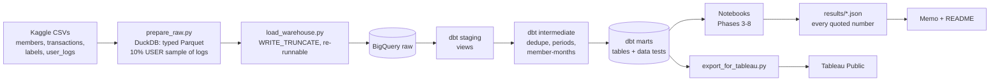

# StreamPulse — who churns from a music subscription, when, why, and what it costs

End-to-end analytics project on **KKBox** (a Taiwanese music-streaming service, WSDM Cup churn data):
BigQuery warehouse → dbt models with tests → cohort, revenue and churn-driver analysis → experiment
design → a real A/B test analysis → forecast → Tableau dashboard → 1-page recommendation memo.

> **Status:** pipeline built and tested on synthetic data; real-data run in progress.
> Findings below are filled in **only** from `results/*.json` produced by running the code on the real data.

| | |
|---|---|
| **Business question** | Who churns, when, why, what does churn cost, and what should KKBox do about it? |
| **Data** | KKBox churn dataset (Kaggle WSDM Cup 2018): members, transactions, daily listening logs, churn labels · Cookie Cats A/B test (real) |
| **Stack** | Google BigQuery (sandbox) · dbt Core · Python (pandas, statsmodels, scipy, scikit-learn) · Tableau Public · GitHub Actions |
| **Dashboard** | _Tableau Public link — added after Phase 9_ |
| **Memo** | [`memo/`](memo/) — added after Phase 10 |

---

## Key findings

_Filled in from `results/phase03…08_*.json` after the real-data run. No number appears here until it has been computed._

| # | Finding | Source |
|---|---|---|
| 1 | _pending_ | `results/phase03_retention.json` |
| 2 | _pending_ | `results/phase04_revenue_ltv.json` |
| 3 | _pending_ | `results/phase05_churn_drivers.json` |
| 4 | **Cookie Cats:** moving the first gate from level 30 to 40 lowered 7-day retention from 19.02% to 18.20% (−0.82 pp, 95% CI −1.33 to −0.31, p = 0.002). Recommendation: don't ship — with the caveat that the 50.4/49.6 group split fails the sample-ratio check (p = 0.009). | [`results/phase07_ab_test.json`](results/phase07_ab_test.json) |

---

## Architecture



The same dbt models also run on **DuckDB** against a synthetic fixture: that is how CI (GitHub Actions)
tests every model and notebook on every push without touching BigQuery or the real data.
Details: [`docs/architecture.md`](docs/architecture.md).

## Data model

| Model | Grain | What it's for |
|---|---|---|
| `fct_subscriptions` | one subscription period | Plan, price, auto-renew, cancel-aware end date, churned-or-renewed |
| `dim_members` | one member | Demographics, signup cohort, first plan, churn label, sample flag |
| `fct_daily_activity` | member × day ⚠️ sampled | Plays, completion rate, listening minutes |
| `mart_monthly_kpis` | month | Active subscribers, revenue, ARPU, renewal churn |
| `mart_cohort_retention` | cohort × plan group × month | Retention curves |
| `mart_churn_by_segment` | dimension × segment | Churn rate, lift vs overall |
| `mart_value_at_risk` | behaviour segment | Revenue lost to churn |
| `mart_ltv_by_segment` | dimension × segment | Observed 12-month value |
| `mart_churn_features` | labelled member | Leakage-safe model features (≤ 28 Feb 2017) |
| `mart_daily_revenue` | day | Seasonal forecast input |
| `mart_data_quality` | check | Counts of every data issue handled |

Full column-level dictionary: [`docs/data_dictionary.md`](docs/data_dictionary.md) (also in `dbt docs`).

## ⚠️ Sampled and simulated data — where it appears

| What | Where | Why |
|---|---|---|
| **10% user sample of listening logs** | `fct_daily_activity`, listening features, Model B in Phase 5 | BigQuery sandbox has a 10 GB cap; logs are far larger. Sampling is by user (deterministic md5 bucket), so each sampled user's history is complete. See [`docs/sampling.md`](docs/sampling.md). |
| **Experiment design (Phase 6)** | `notebooks/06_…`, `docs/experiment_design.md` | KKBox ran no experiment. Only the baseline churn and volume are real; effects are design targets. |
| **Synthetic fixture** | `scripts/make_fixture.py`, CI only | Tests code. Outputs are quarantined in `results/_SYNTHETIC_TEST_ONLY/` (git-ignored). Never reported. |

Everything else (members, transactions, labels, Cookie Cats) is complete real data.

## Limitations

- KKBox data is **Taiwan, 2015–2017**, prices in **NTD**. Patterns, not current market numbers.
- **Left-censoring:** data starts 2015-01-01, so the first 6 months under-count active subscribers and cohort analysis only uses members registered on/after that date.
- **One label month** (March 2017 expiries): the churn model is validated with a random split, not out-of-time.
- **Associations, not causes:** churn drivers describe who churns; only an experiment (Phase 6 design) can show what reduces churn.
- Listening-based findings come from a **10% user sample**.
- Cookie Cats shows a **sample ratio mismatch**; its result should be confirmed after the assignment issue is understood.

## How to reproduce

Step-by-step, with the reasoning behind every step: [`docs/walkthroughs/`](docs/walkthroughs/).

```bash
# 0. environment (Windows: .venv\Scripts\activate)
python -m venv .venv && source .venv/bin/activate
pip install -r requirements.txt
cp dbt/streampulse/profiles.example.yml ~/.dbt/profiles.yml   # set YOUR_PROJECT_ID
gcloud auth application-default login

# 1. data: download + extract the KKBox files into data/raw/, then
python scripts/prepare_raw.py --raw-dir data/raw --out-dir data/prepared --sample-pct 10
python scripts/load_warehouse.py --target bigquery --project YOUR_PROJECT_ID

# 2. models + tests
cd dbt/streampulse && dbt build --target bigquery && dbt docs generate && cd ../..

# 3-8. analysis (set STREAMPULSE_TARGET=bigquery and GCP_PROJECT=YOUR_PROJECT_ID first)
jupyter lab notebooks/

# 9. dashboard extracts
python scripts/export_for_tableau.py
```

**Test the whole pipeline without any downloads** (what CI runs):

```bash
python scripts/smoke_test.py
```

> The BigQuery sandbox deletes tables after **60 days**. If they're gone, re-run steps 1–2: the loader replaces tables, so it's safe to run any number of times.
